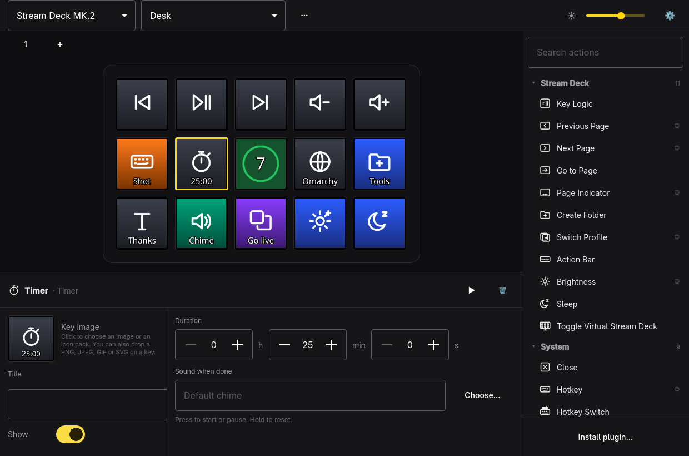

# Stream Deck for Linux

A Linux port of the Elgato Stream Deck app (7.6), built for Omarchy and
Hyprland: an editor, a background service, the Stream Deck SDK plugin host,
and a Stream Deck widget for the Omarchy bar.



Profiles use the original app's format, so `.streamDeckProfile` files
exported on macOS or Windows import as they are, and plugins written with
Elgato's Node.js SDK run unchanged.

## What's in it

| Part | What it does |
|---|---|
| `streamdeckd` (Rust, `daemon/`) | Talks to every Stream Deck model over HID, draws keys and screens, runs the built-in actions, hosts plugins on the SDK WebSocket, switches profiles with the focused app, sleeps and backs up. Runs as a systemd user service. |
| `streamdeck` (C++/Qt Quick, `app/`) | The editor: drag actions onto keys and dials, edit titles and images, profiles, pages and folders, plugin property inspectors, preferences. `streamdeck vsd` opens the Virtual Stream Deck. |
| Bar widget (`shell/streamdeck-linux.deck`) | Shows the active profile in the Omarchy bar. Click for a live view of the keys (click one to press it), profile and page switching, brightness and sleep. Right-click opens the editor; scroll turns pages. |

### Features of the original, and where they stand

| Original feature | Here |
|---|---|
| Stream Deck, MK.2, Mini, XL, +, + XL, Neo, Pedal, Scissor and Module variants | ✓ (via the `elgato-streamdeck` crate) |
| Keys, dials, the + touch strip and Neo info bar, touch points | ✓ |
| Profiles, pages, folders, default page | ✓ |
| Smart profiles (switch with the focused app) | ✓ (Hyprland window class) |
| Import/export `.streamDeckProfile` (current and 4.x/5.x formats) | ✓ |
| Backups and restore (automatic, every 6 h, configurable) | ✓ |
| All 33 built-in actions (all but the original's internal debug action), multi actions, key logic, action wheel, action trigger, dial stack, plus Mute Microphone | ✓, see [docs/ACTIONS.md](docs/ACTIONS.md) |
| Titles: font, size, style, underline, colour, alignment, multi-line | ✓ |
| Custom key images (PNG, JPEG, GIF, SVG, WebP), icon packs (`.streamDeckIconPack`) | ✓ |
| Plugins (`.streamDeckPlugin`): Node.js SDK plugins, HTML plugins, property inspectors | ✓ |
| Elgato Marketplace | Partly: "Open in Stream Deck" links name the item and say whether it is installed, but Elgato requires signing in to download, so download the `.streamDeckPlugin` file and open it. Plugins that ship only macOS/Windows programs, or an encrypted manifest, cannot run. |
| SDK events: settings, global settings, titles, images, states, alerts, feedback layouts, trigger descriptions, resources, deep links (`streamdeck://`), monitored applications, wake from sleep | ✓ |
| Virtual Stream Deck, any size | ✓ |
| Brightness, sleep timer, key press feedback | ✓ |
| Elgato Marketplace, Elgato account, Twitch sign-in | ✗ online services of Elgato's |
| Stream Deck Mobile, Corsair iCUE / G-keys, XLR Dock and Galleon keyboards | ✗ need Elgato/Corsair services or SDKs |
| Firmware updates | ✗ |
| Plugins that ship only a macOS or Windows binary | ✗ they cannot run; the editor says so |

## Install

On Omarchy (or any Arch system with Rust's `cargo`):

```sh
bin/install                                  # builds and installs the package
systemctl --user enable --now streamdeckd    # start the service with your session
streamdeck-omarchy-widget install            # put the widget on the Omarchy bar
```

Unplug and replug the Stream Deck once so the new udev rule lets you open it
without root. Then start **Stream Deck** from the launcher (Super + Space).

Another program that drives Stream Decks (StreamController, OpenDeck, Boatswain)
holds the device exclusively; quit it first. `journalctl --user -u streamdeckd`
says so when it cannot open a deck.

## Using it

Drag an action from the list on the right onto a key or dial; select a key to
change its title, image and settings below. Double-click a folder to fill it.
Drop a `.streamDeckPlugin`, `.streamDeckProfile` or `.streamDeckIconPack`
anywhere on the window to install it.

| Key | Does |
|---|---|
| Space | Press the selected key |
| Delete | Clear the selected key |
| Ctrl + C / X / V | Copy, cut, paste a key |
| Ctrl + Z, Ctrl + Shift + Z | Undo, redo |
| PgUp / PgDn | Previous / next page |
| Esc | Deselect, or leave a folder |
| Ctrl + F | Search actions |
| Ctrl + , | Preferences |
| Ctrl while dragging a key | Copy instead of move |
| ? | All shortcuts |
| Q | Quit |

From a terminal:

```sh
streamdeckd status                                  # devices, profiles, pages
streamdeckd ctl listProfiles '{"device": "…"}'      # any control API method
streamdeckd open ~/Downloads/thing.streamDeckPlugin # install or import a file
```

## How it works on Linux

- **Hotkeys, media keys, mouse wheel**: a uinput device (logind already gives
  the seat user access to `/dev/uinput`), so they work in every Wayland app and
  media keys show Omarchy's on-screen display. Text uses `wtype` or the
  clipboard.
- **Applications**: desktop entries for launching; Hyprland for focusing,
  closing and for smart profiles.
- **Plugins**: started as
  `node <CodePath> -port … -pluginUUID … -registerEvent registerPlugin -info …`,
  exactly as the original starts them. A plugin can add a `CodePathLin` with a
  native Linux build. HTML plugins run in the editor's web engine
  (`streamdeck plugin-host`). Plugin logs are in
  `~/.local/share/streamdeck-linux/logs/`.
- **Data**: `~/.local/share/streamdeck-linux/` (profiles in `ProfilesV2/`,
  `Plugins/`, `IconPacks/`, `Backups/`), settings in
  `~/.config/streamdeck-linux/settings.json`.
- **Control API**: everything the editor and the bar widget do goes through
  one Unix socket, documented in [docs/CONTROL_API.md](docs/CONTROL_API.md).

## Develop

```sh
(cd daemon && cargo build)      # service
app/bin/build                   # editor
bin/test                        # every test: service, editor, bar widget
tools/dev-daemon                # a service with throwaway data and no hardware
STREAMDECK_FAKE=plus,neo tools/dev-daemon   # …plus simulated models
```

`examples/com.example.counter.sdPlugin` is a dependency-free plugin that
exercises keys, dials, settings and its property inspector.

The built-in action icons are generated by `tools/gen_builtin.py`.

## Notes

This is an independent project, not affiliated with or endorsed by Elgato or
Corsair. "Stream Deck" and "Elgato" are their trademarks. It contains no code
or artwork from the original app; built-in actions keep the original's action
identifiers only so that existing profiles keep working.
